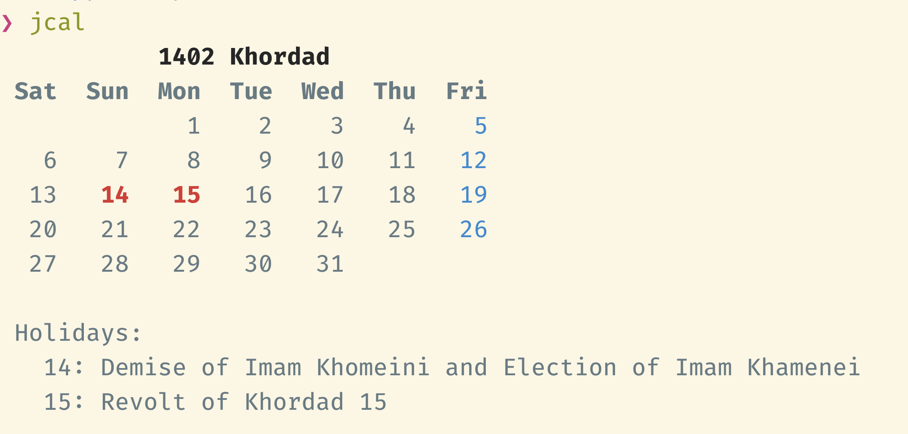
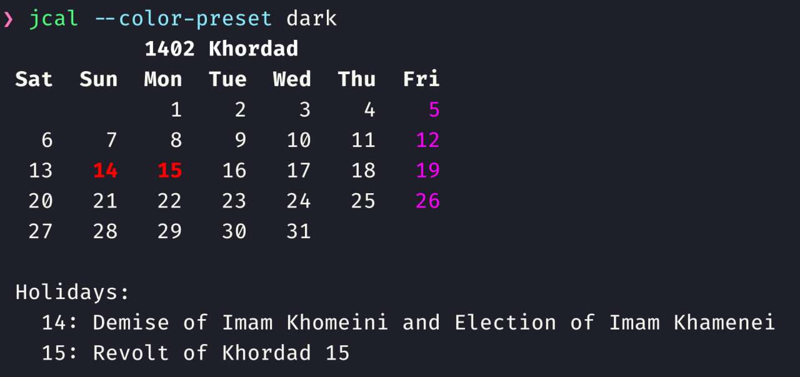
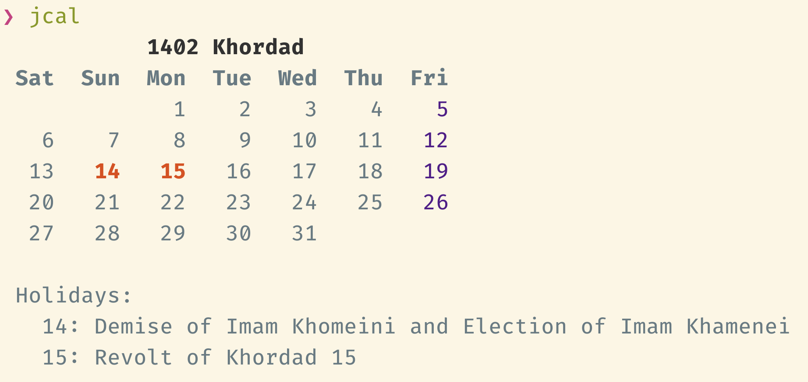
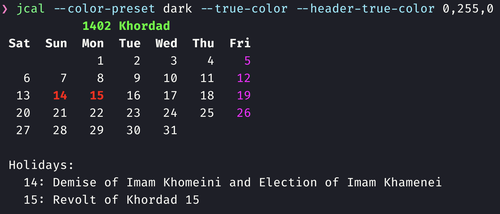
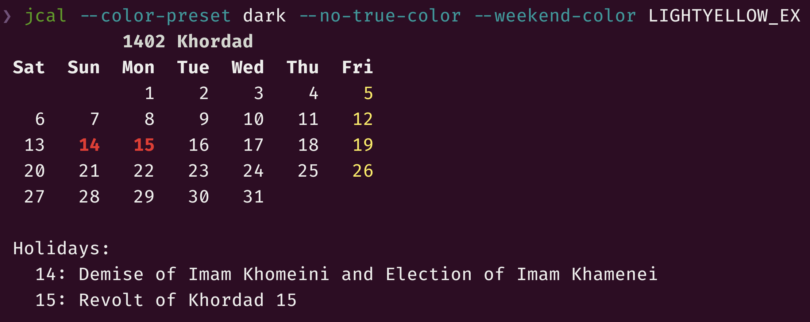
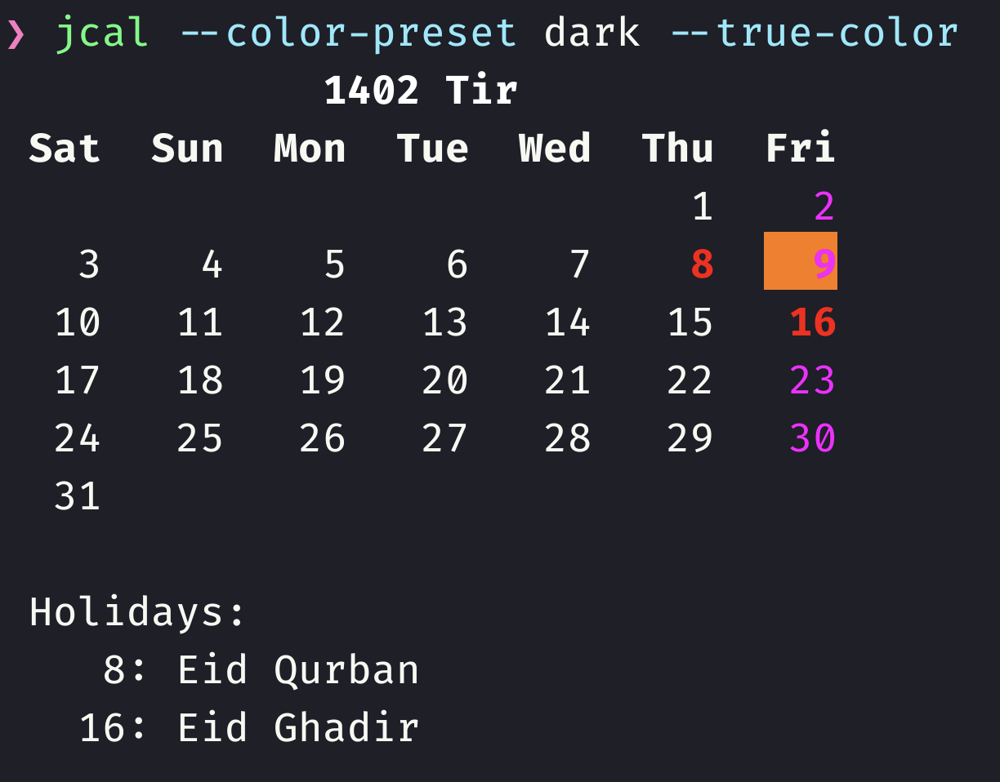

#+TITLE: jalali-calendar-cli

Jalali (Shamsi) and Gregorian calendars in your terminal, with holidays: Iranian official holidays, the days off of LMU Munich staff, or both overlaid on one grid. There is also a static HTML version.

* Install
#+begin_example bash
pip install -U jalali-calendar-cli
#+end_example

This requires Python ≥3.10.

The package installs these commands:

- =jcal= (alias =jalali-calendar=): a Jalali month with Iranian holidays.
- =jcal-all=: all months of a Jalali year.
- =gcal-lmu= and =gcal-lmu-all=: a Gregorian month, or year, with LMU Munich days off.
- =gcal=: a Gregorian month with the holiday set(s) chosen by =--sources=.
- =gcal-lmu-iran= and =gcal-lmu-iran-all=: LMU days off on a Gregorian grid, with Iranian holidays overlaid.
- =jcal-iran-lmu= and =jcal-iran-lmu-all=: the mirror image, Iranian holidays on a Jalali grid with LMU days off overlaid.
- =jcal-html=: writes a static HTML page with all of the above.

See [[file:docs/calendars.org][docs/calendars.org]] for where the holiday data comes from and how the code is organized.

* Usage
# #+ATTR_HTML: :width 884
# 
#+ATTR_HTML: :width 914

#+ATTR_HTML: :width 900

#+begin_example bash
usage: jcal [-h] [--color {auto,always,never}]
            [--true-color | --no-true-color] [--footnotes | --no-footnotes]
            [--indentation INDENTATION] [--line-prefix LINE_PREFIX]
            [--color-preset {light,dark}]
            [--weekend-true-color WEEKEND_TRUE_COLOR]
            [--weekend-color WEEKEND_COLOR]
            [--holiday-true-color HOLIDAY_TRUE_COLOR]
            [--holiday-color HOLIDAY_COLOR]
            [--header-true-color HEADER_TRUE_COLOR]
            [--header-color HEADER_COLOR]
            [--today-true-color TODAY_TRUE_COLOR] [--today-color TODAY_COLOR]
            [--shared-true-color SHARED_TRUE_COLOR]
            [--shared-color SHARED_COLOR]
            [--secondary-holiday-true-color SECONDARY_HOLIDAY_TRUE_COLOR]
            [--secondary-holiday-color SECONDARY_HOLIDAY_COLOR]
            [--secondary-weekend-true-color SECONDARY_WEEKEND_TRUE_COLOR]
            [--secondary-weekend-color SECONDARY_WEEKEND_COLOR]
            [--holidays-json-path HOLIDAYS_JSON_PATH]
            [--holidays-fallback | --no-holidays-fallback]
            [--iran-weekend IRAN_WEEKEND]
            [month] [year]

positional arguments:
  month                 month in Jalali calendar (default: current month)
  year                  year in Jalali calendar (default: current year)

options:
  -h, --help            show this help message and exit
  --color {auto,always,never}
                        colorize the output
  --true-color, --no-true-color
                        use 24-bit colors (default: when the terminal
                        advertises them)
  --footnotes, --no-footnotes
                        show footnotes in the output
  --indentation INDENTATION
                        number of spaces for indentation (default: 5)
  --line-prefix LINE_PREFIX
                        a prefix that is added to all lines of the output
                        (default: ' ')
  --color-preset {light,dark}
                        color preset for the calendar output (default: light)

24-bit true color options:
  --weekend-true-color WEEKEND_TRUE_COLOR
                        RGB values for weekend color in 24-bit true color
  --holiday-true-color HOLIDAY_TRUE_COLOR
                        RGB values for holiday color in 24-bit true color
  --header-true-color HEADER_TRUE_COLOR
                        RGB values for header color in 24-bit true color
  --today-true-color TODAY_TRUE_COLOR
                        RGB values for the current day's color in 24-bit true
                        color
  --shared-true-color SHARED_TRUE_COLOR
                        RGB values for the background of days on which both
                        shown holiday sets are free in 24-bit true color
  --secondary-holiday-true-color SECONDARY_HOLIDAY_TRUE_COLOR
                        RGB values for the background of the second holiday
                        set's holidays in 24-bit true color
  --secondary-weekend-true-color SECONDARY_WEEKEND_TRUE_COLOR
                        RGB values for the background of the second holiday
                        set's weekend in 24-bit true color

colorama 256 color options:
  --weekend-color WEEKEND_COLOR
                        colorama color name for weekend color
  --holiday-color HOLIDAY_COLOR
                        colorama color name for holiday color
  --header-color HEADER_COLOR
                        colorama color name for header color
  --today-color TODAY_COLOR
                        colorama color name for the current day's color
  --shared-color SHARED_COLOR
                        colorama color name for the background of days on
                        which both shown holiday sets are free
  --secondary-holiday-color SECONDARY_HOLIDAY_COLOR
                        colorama color name for the background of the second
                        holiday set's holidays
  --secondary-weekend-color SECONDARY_WEEKEND_COLOR
                        colorama color name for the background of the second
                        holiday set's weekend

holiday data:
  --holidays-json-path HOLIDAYS_JSON_PATH
                        path to JSON file containing Iranian holiday data
                        (default: the bundled data, or
                        $JALALI_HOLIDAYS_JSON_PATH)
  --holidays-fallback, --no-holidays-fallback
                        for years missing from the holidays JSON, compute
                        Iranian holidays with the `holidays` package (lunar
                        dates are estimates)
  --iran-weekend IRAN_WEEKEND
                        comma-separated weekdays that are the weekend in Iran
                        (default: thu,fri; use 'fri' for the official reading)
#+end_example

** Examples
#+begin_example bash
jcal 12
#+end_example

#+begin_example
            1402 Esfand           
 Sat  Sun  Mon  Tue  Wed  Thu  Fri
                  1    2    3    4
   5    6    7    8    9   10   11
  12   13   14   15   16   17   18
  19   20   21   22   23   24   25
  26   27   28   29

 Holidays:
    6: Birthday of Imam Mahdi
   29: Nationalization of the Oil Industry
#+end_example

#+begin_example bash
jcal 7 1402
#+end_example

#+begin_example
             1402 Mehr            
 Sat  Sun  Mon  Tue  Wed  Thu  Fri
   1    2    3    4    5    6    7
   8    9   10   11   12   13   14
  15   16   17   18   19   20   21
  22   23   24   25   26   27   28
  29   30

 Holidays:
    2: Martyrdom of Imam Hassan Askari and Start of Imamate of Imam Mahdi
   11: Birthday of Prophet Muhammad and Imam Sadiq
#+end_example

#+ATTR_HTML: :width 968

#+ATTR_HTML: :width 968

*** Shell Aliases in Bash
You can add aliases to =~/.bashrc= and =~/.bash_profile= to persist your settings:

#+begin_example bash
alias jcal='command jcal --color-preset dark'
#+end_example

Aliases work the same way in Zsh, you just need to add them to =~/.zshenv=.

*** Today
The current day is highlighted:
#+ATTR_HTML: :width 874

*** Seeing All Months Together
=jcal-all= prints all months of a year together, three per row:

#+begin_example zsh
jcal-all 1402 --outer-indent 2 --horizontal-indent 1
#+end_example

#+begin_example
       1402 Farvardin               1402 Ordibehesht                1402 Khordad        
 Sat Sun Mon Tue Wed Thu Fri   Sat Sun Mon Tue Wed Thu Fri   Sat Sun Mon Tue Wed Thu Fri
               1   2   3   4                             1             1   2   3   4   5
   5   6   7   8   9  10  11     2   3   4   5   6   7   8     6   7   8   9  10  11  12
  12  13  14  15  16  17  18     9  10  11  12  13  14  15    13  14  15  16  17  18  19
  19  20  21  22  23  24  25    16  17  18  19  20  21  22    20  21  22  23  24  25  26
  26  27  28  29  30  31        23  24  25  26  27  28  29    27  28  29  30  31        
                                30  31                                                  

          1402 Tir                     1402 Mordad                 1402 Shahrivar       
 Sat Sun Mon Tue Wed Thu Fri   Sat Sun Mon Tue Wed Thu Fri   Sat Sun Mon Tue Wed Thu Fri
                       1   2         1   2   3   4   5   6                     1   2   3
   3   4   5   6   7   8   9     7   8   9  10  11  12  13     4   5   6   7   8   9  10
  10  11  12  13  14  15  16    14  15  16  17  18  19  20    11  12  13  14  15  16  17
  17  18  19  20  21  22  23    21  22  23  24  25  26  27    18  19  20  21  22  23  24
  24  25  26  27  28  29  30    28  29  30  31                25  26  27  28  29  30  31
  31                                                                                    

          1402 Mehr                     1402 Aban                     1402 Azar         
 Sat Sun Mon Tue Wed Thu Fri   Sat Sun Mon Tue Wed Thu Fri   Sat Sun Mon Tue Wed Thu Fri
   1   2   3   4   5   6   7             1   2   3   4   5                     1   2   3
   8   9  10  11  12  13  14     6   7   8   9  10  11  12     4   5   6   7   8   9  10
  15  16  17  18  19  20  21    13  14  15  16  17  18  19    11  12  13  14  15  16  17
  22  23  24  25  26  27  28    20  21  22  23  24  25  26    18  19  20  21  22  23  24
  29  30                        27  28  29  30                25  26  27  28  29  30    

          1402 Dey                     1402 Bahman                   1402 Esfand        
 Sat Sun Mon Tue Wed Thu Fri   Sat Sun Mon Tue Wed Thu Fri   Sat Sun Mon Tue Wed Thu Fri
                           1         1   2   3   4   5   6                 1   2   3   4
   2   3   4   5   6   7   8     7   8   9  10  11  12  13     5   6   7   8   9  10  11
   9  10  11  12  13  14  15    14  15  16  17  18  19  20    12  13  14  15  16  17  18
  16  17  18  19  20  21  22    21  22  23  24  25  26  27    19  20  21  22  23  24  25
  23  24  25  26  27  28  29    28  29  30                    26  27  28  29            
  30
#+end_example

** Gregorian Calendar with LMU Munich Days Off
=gcal-lmu= shows a Gregorian month, weeks starting on Monday, with the days off of LMU Munich staff: Bavarian public holidays (including Assumption Day, which applies in Munich) plus December 24 and 31, which TV-L gives off.

#+begin_example bash
gcal-lmu 12 2026
#+end_example

#+begin_example
           2026 December
 Mon  Tue  Wed  Thu  Fri  Sat  Sun
        1    2    3    4    5    6
   7    8    9   10   11   12   13
  14   15   16   17   18   19   20
  21   22   23   24   25   26   27
  28   29   30   31

 Holidays:
   24: Christmas Eve (TV-L)
   25: Christmas Day
   26: Second Day of Christmas
   31: New Year's Eve (TV-L)
#+end_example

=gcal-lmu-all 2026= prints the whole year; =--footnotes= adds a list of its days off. =gcal --sources lmu= is the same as =gcal-lmu=; it is where more holiday sets will go.

** Two Holiday Sets on One Grid
=gcal-lmu-iran= draws LMU days off on a Gregorian grid and overlays Iranian holidays; =jcal-iran-lmu= draws Iranian holidays on a Jalali grid and overlays LMU days off. Both have an =-all= year view.

In color, each set has its own channel:
- *text color* is the first set: red for a holiday, magenta for its weekend;
- *background* is the second set: a strong tint for a holiday, a faint tint for its weekend, which runs down the whole column from the weekday label;
- a *gold background* marks a day on which both sides are free, whether by holiday or by weekend. It takes the place of the second set's tint, and the text keeps the first set's color.

The background thus goes from nothing to faint (their weekend), strong (their holiday) and gold (both free); the footnotes say why. In the overlay views today is bold and underlined rather than highlighted, so that the background keeps this meaning.

A second title line gives the other calendar's months (in the year views it shares the title line, abbreviated, as in =2026 March · Esf–Far=), and the footnotes are tagged with their set. Entries of the second set carry their date in their own calendar:

#+begin_example bash
gcal-lmu-iran 6 2026 --color never
#+end_example

#+begin_example
             2026 June
         Khordad–Tir 1405
 Mon  Tue  Wed  Thu  Fri  Sat  Sun
   1    2    3    4    5    6    7
   8    9   10   11   12   13   14
  15   16   17   18   19   20   21
  22   23   24   25   26   27   28
  29   30

 Holidays:
    4: LMU  Corpus Christi
    4: IR   Eid Saeed Ghadir Khumm - Demise of Imam Khomeini (14 Khordad)
    5: IR   Revolt of 15 Khordad (15 Khordad)
   24: IR   Tasu'a Hosseini (3 Tir)
   25: IR   Ashura Hosseini (4 Tir)
#+end_example

The Iranian weekend is Thursday and Friday by default; =--iran-weekend fri= gives the official reading, where only Friday is the weekend.

** HTML Page
=jcal-html --out DIR= writes =index.html=, =theme.css= and =app.js= to =DIR=: a static page, built for phones, with the four views (LMU, LMU + Iran, Iran, Iran + LMU) for last year through two years ahead (=--from-year=, =--to-year=). It uses the same colors as the terminal, has a month and a year mode, marks today in the browser, and has a manual light/dark switch. Running it again on the same inputs rewrites nothing. =site/holidays/refresh.sh= builds it from a checkout of this repository.

** =colorama= Colors
These colors are defined by your terminal theme, and are used when the terminal does not advertise 24-bit color.

24-bit (true) colors, which are specified in RGB, are used by default when the terminal advertises them: =COLORTERM= is =truecolor= or =24bit=, =TERM= ends in =-direct=, or the terminal is one known to support them (kitty, Ghostty, Alacritty, WezTerm, iTerm2, VS Code). =--true-color= forces them, for example over an ssh connection that drops =COLORTERM=, and =--no-true-color= turns them off. The default =light= preset is meant for light terminal themes; use =--color-preset dark= on a dark one.

#+begin_example
BLACK
BLUE
CYAN
GREEN
LIGHTBLACK_EX
LIGHTBLUE_EX
LIGHTCYAN_EX
LIGHTGREEN_EX
LIGHTMAGENTA_EX
LIGHTRED_EX
LIGHTWHITE_EX
LIGHTYELLOW_EX
MAGENTA
RED
RESET
WHITE
YELLOW
#+end_example

* Holiday Data
The default data dictionary is [[https://github.com/NightMachinery/jalali-calendar-cli/blob/master/jalali_calendar_cli/holidays.json][here]]. I plan to keep the data up-to-date for the upcoming years, but you can always supply your own.

The bundled holiday data currently covers years 1402 through 1405. The holiday data of previous years (≤1401) has not been added.

For years the data does not cover, the Iranian holidays are computed by the [[https://pypi.org/project/holidays/][holidays]] package. Its Islamic (lunar) dates are estimates, marked "(estimated)", and can be off by a day; =--no-holidays-fallback= turns this off. In every leap year, 30 Esfand is added as a holiday: it is always an official holiday, as part of the 29 Esfand to 4 Farvardin span.

LMU Munich days off come from the =holidays= package as well (Bavaria, with Assumption Day), plus December 24 and 31.

